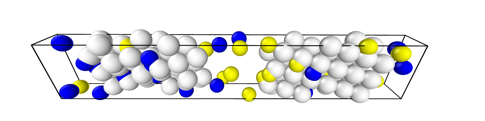

# mattergen-interface

> [!IMPORTANT]
> This repository is a modified version of [microsoft/mattergen](https://github.com/microsoft/mattergen) (snapshot of September 2025). It is **not** affiliated with,
> endorsed by, or supported by Microsoft. Original work: Copyright (c) Microsoft Corporation. Modifications: Copyright (c) 2026 nmdl-mizo. Both under the MIT License (see `LICENSE`, `NOTICE`).

Reference implementation, trained weights and data of the paper "Generating grain boundary structures at a specified energy with a symmetry-constrained diffusion model" (submitted to APL Machine Learning).

<p align="center">
  
</p>
<p align="center"><em>Denoising trajectory of one Al Σ5(210)[001] bicrystal (114 atoms) generated by the proposed model (target gamma 1.53 J/m^2, guidance factor w = 2.0).
Blue: primary; yellow: replica (reconstructed from the primary by the symmetry operation at every step); white: bulk (fixed).</em></p>

In file names, configuration names and environment variables, `scm` is the abbreviation of *symmetry-constrained MatterGen* (for example the `scm_*` configurations and `SCM_HOST_Z`).

## 1. Overview

Under periodic boundary conditions a bicrystal cell contains two grain boundaries (GBs), so the excess energy of the cell stands for a single GB only if the two are equivalent.
We fine-tune MatterGen so that one GB is generated and the other is reconstructed from it by a symmetry operation (a 2_1 screw operation) at every denoising step, with the bulk
regions fixed. The model is conditioned on the GB energy gamma (J/m^2) with classifier-free guidance and is evaluated for Al Sigma5(210)[001] symmetric tilt GBs, with relaxation
by the MLIP MACE-MH-1 (head omat_pbe) and DFT spot checks.
Terms used in the code and data: the *proposed model* is the symmetry-constrained model (`proposed` in file names); the *unconstrained baseline* is MatterGen fine-tuned on the same data
without the constraint (`baseline` in file names).

## 2. Differences from upstream MatterGen

| | proposed model (symmetry-constrained) | unconstrained baseline |
|---|---|---|
| variables that diffuse | coordinates and species of the primary half, the in-plane translation, and the cell extension along the normal | coordinates and species of all atoms, and the cell |
| loss | applied to those variables | all atoms and the cell |
| data representation | relaxed structure ordered as bulk on both sides, primary, replica, with its actual cell | crystal structure passed through the standard MatterGen data transformations |
| initial state of generation | bulk part and cell are given by the construction; primary, in-plane translation and cell extension are generated from noise | all atoms and the lattice are generated from noise |
| atoms fixed during relaxation | generated bulk atoms (76) | none |

Identical in both: the training rows and split, optimizer settings and epochs, the starting model (`mattergen_base`), the probability of dropping the condition, the distribution of the number of atoms,
the gamma targets, and the relaxation software and settings. The code is in `mattergen/symmetry_constrained/` and `mattergen/symmetry_constrained/variable_length/` (adapter, diffusion module, projection, layout, dataset),
the generator is `scripts/generate_symmetry_constrained.py`, and the training configurations are `mattergen/conf/finetune-scm-al-proposed.yaml` (proposed) and
`mattergen/conf/finetune-scm-al-baseline-dedup.yaml` (baseline). The state of the code at training time and the renaming of the extension packages for this release are described in `NOTICE`. The upstream README is kept as `UPSTREAM_README.md`.

Names in this release: the extension packages and their classes, the environment variables (`SCM_HOST_Z`, `SCM_SOLUTE_ZS`, `SCM_N_BULK_PER_GRAIN`), the configuration names (`scm_*`) and the num_atoms key (`AL_S5_210_TRAIN`) are the ones used in this repository; the checkpoints and the configuration files of the data record (`proposed_resolved_config.yaml`, `baseline_resolved_config.yaml`) use these names, and no compatibility layer for any earlier name is included. Code of the development repository that the published models do not reach (the variable-atom-count extension and the fixed-length layout code) was removed (`NOTICE`, section 3). `SCM_HOST_Z` is the atomic number of the host element (13 for Al). `SCM_SOLUTE_ZS` lists the atomic numbers of solute species that the layout code accepts in addition to the host; it must be exported as an empty string for the models of the paper, which contain no solute (the generator and the training and evaluation scripts refuse to run when it is unset).

The training structures were built with the grain-boundary construction code *interface_master* (Y. S. Xie, K. Shibata, T. Mizoguchi; MIT License; arXiv:2211.15173): Stage 0 of `structure_builder/` uses it. The working copy that was used is bundled unmodified in `structure_builder/vendor/interfacemaster/` together with its MIT license text; the release on PyPI (1.1.7) was not used, for the reasons given in `structure_builder/README.md`. The reference is in section 7 and in `CITATION.cff`; the license text is in `NOTICE`, section 5.

## 3. Installation

Two environments are used (see `docs/reproduce.md`): generation/training (CPython 3.10, CUDA 12.8) and evaluation/plotting.

```bash
git clone https://github.com/nmdl-mizo/mattergen-interface && cd mattergen-interface
# generation / training
uv venv .venv --python 3.10 && source .venv/bin/activate
uv pip install -r environment-gen.txt && uv pip install -e .
# evaluation / plotting
conda env create -n gbrel-eval -f environment-eval.yml
```

## 4. Trained weights and data

Weights and data are in one Zenodo record: https://doi.org/10.5281/zenodo.23667782 (DOI `10.5281/zenodo.23667782`). After downloading, verify with `sha256sum -c SHA256SUMS`.

| item in the record | content |
|---|---|
| `proposed_epoch159.ckpt`, `baseline_epoch129.ckpt` | proposed model (epoch 159, validation loss 0.6371) and unconstrained baseline (epoch 129); SHA-256 values are listed in `docs/reproduce.md` |
| `proposed_resolved_config.yaml`, `baseline_resolved_config.yaml` | the resolved training configurations of the two checkpoints |
| `baseline_model_config.yaml` | the complete model configuration of the baseline for generation through `mattergen.scripts.generate` (`docs/reproduce.md`) |
| `training.tar.gz` | training CSV, split, manifests, and the 6,510 relaxed training structures |
| `generation.tar.gz`, `relaxation.tar.gz`, `evaluation.tar.gz` | generated structures, relaxed structures with gamma values, novelty / GB-equivalence / grid-interpolation / dx-gamma results |
| `dft.tar.gz` | DFT inputs (without POTCAR), selected outputs, `gamma_vasp.csv`, and the TITEL lines of the POTCAR files used |

Not included, and how to obtain them:

- **MACE-MH-1 model file** (the interatomic potential, head `omat_pbe`): obtain it from the distribution referenced in arXiv:2510.25380 (https://arxiv.org/abs/2510.25380).
  The file used here had SHA-256 `ec00a2705854622fbbd898ccfb7701072fcd674709102d009fb919c1b8cc5dde`. Its redistribution terms were not checked, so it is not bundled.
- **`mattergen_base`** (the starting checkpoint of the fine-tuning): download the model `mattergen_base` of microsoft/mattergen from Hugging Face (MIT licensed). It is not needed to run the released checkpoints.
- **VASP POTCAR files**: not redistributable (VASP license). The pseudopotentials used are listed by their TITEL lines in the data record (`dft/POTCAR_SPEC.txt`; PAW_PBE Al).

## 5. Reproduction

| level | what | cost | details |
|---|---|---|---|
| R0 | the 10 figures and the numbers from the released files | CPU, minutes | `docs/reproduce.md` |
| R1 | relaxation and gamma of generated structures against the published values | 1 GPU | `docs/reproduce.md`, `gb_eval/smoke/r1_relax_compare.py` |
| R2 | generation from the released checkpoint | 1 GPU | `docs/reproduce.md`, `scripts/generate_symmetry_constrained.py` |
| R3 | training | several GPU-days (commands recorded, not re-run) | `docs/reproduce.md` |
| S | rebuild parts of the training data (the construction of the 6,510 structures) with `structure_builder/` and compare with the released data | CPU (stages 0 - B, D, E), 1 GPU (stage C) | `structure_builder/README.md` |

`data/README.md` lists the primary files under `data/paper_numbers/` and the paper's numbers and figures they support.

## 6. Repository layout

```
mattergen/        modified MatterGen package (symmetry_constrained/, symmetry_constrained/variable_length/, configs in conf/)
scripts/          generator for the proposed model
sampling_conf/    upstream sampling configurations
gb_eval/          evaluation scripts (relaxation, novelty, GB equivalence, DFT aggregation, dx-gamma), slurm examples, smoke tests, paths.py
figures/scripts/  figure scripts of the paper
structure_builder/ the pipeline that builds the training structures (templates, dx, atom removal, relaxation, gamma table, de-duplication, split), the bundled interface_master (vendor/) and the smoke tests
data/             primary tables behind the numbers and figures (data/paper_numbers/)
docs/             docs/reproduce.md
environment-gen.txt, environment-eval.yml   environments
LICENSE, NOTICE, CITATION.cff, MODEL_CARD.md   license, notices, citation, description of the two released checkpoints
SECURITY.md, CONTRIBUTING.md                 how to report problems / contribute
UPSTREAM_README.md                           README of upstream MatterGen (kept for reference; its links to files not in this repository point to the upstream repository)
```

## 7. Citation

If you use this repository, please cite it as given in `CITATION.cff` (on GitHub, "Cite this repository" in the sidebar):

```
Miyamoto, K., Okuda, I., Takahara, I. and Mizoguchi, T. mattergen-interface: symmetry-constrained MatterGen for Al Σ5(210)[001] grain boundaries. https://github.com/nmdl-mizo/mattergen-interface
```

The accompanying paper, "Generating grain boundary structures at a specified energy with a symmetry-constrained diffusion model", has been submitted to APL Machine Learning; its reference will be added here when it is published.

Please also cite the works it builds on: Zeni et al., "A generative model for inorganic materials design", Nature 639, 624-632 (2025), doi:10.1038/s41586-025-08628-5 (MatterGen);
Batatia et al., "Cross Learning between Electronic Structure Theories for Unifying Molecular, Surface, and Inorganic Crystal Foundation Force Fields", arXiv:2510.25380 (MACE-MH-1).
Xie, Shibata and Mizoguchi, "interface_master: Python package building CSL and approximate CSL interfaces of any two lattices -- an effective tool for interface engineers", arXiv:2211.15173 (2022), doi:10.48550/arXiv.2211.15173 (interface_master, used to build the training structures).
`CITATION.cff` has the same information.

## 8. License

- Code: MIT License. Original work Copyright (c) Microsoft Corporation; modifications Copyright (c) 2026 nmdl-mizo (`LICENSE`). Third-party notices: `NOTICE`.
- Trained weights: MIT License (the same as the upstream MatterGen weights).
- Data record: Creative Commons Attribution 4.0 International (CC BY 4.0).
- Parts of this README are adapted from the upstream MatterGen README (MIT).

## 9. Acknowledgments and contact

This study was supported by the Ministry of Education, Culture, Sports, Science and Technology (MEXT) Supporting Pioneering Research through AI for 1,000 Discovery challenges Program (SPReAD), Japan, Grant Number JPMXP1781046134, Japan Science and Technology Agency (JST) (Nos. JPMJAX24DB and JPMJBS2418), and JSPS KAKENHI Grant Numbers JP25K24645, JP26K01205, and JP26K22608. Some computations were carried out using the computer resource offered by Research Institute for Information Technology, Kyushu University.

Contact: Kazuya Miyamoto (miya1216@iis.u-tokyo.ac.jp) and Teruyasu Mizoguchi (teru@iis.u-tokyo.ac.jp)
